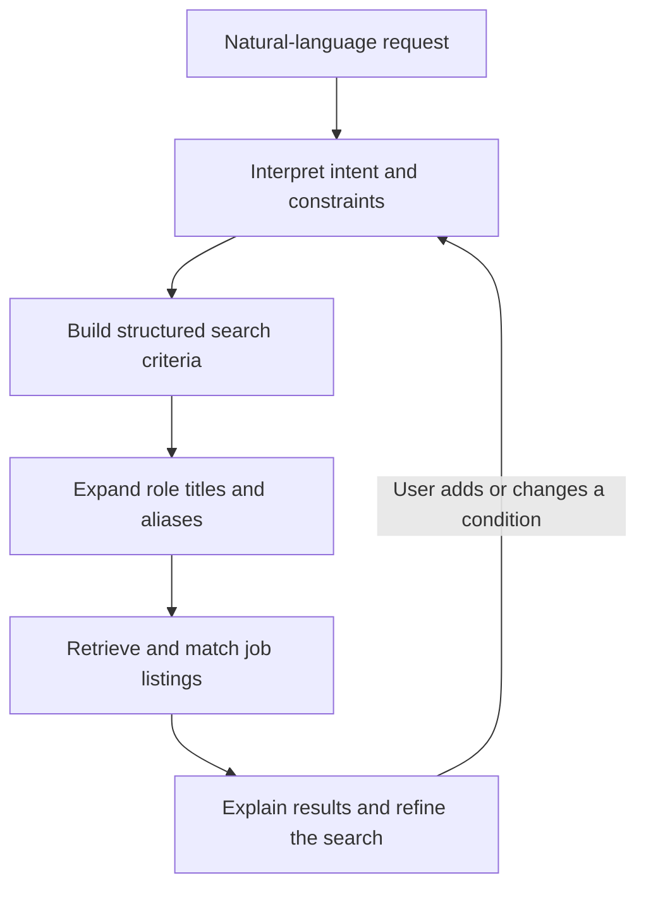
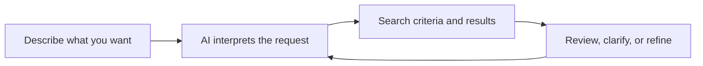
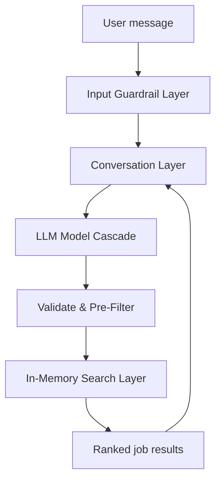

# Conversational Job Search

**An AI-powered approach to searching for jobs with complex, real-world constraints.**

Most job platforms are built around fixed filters and exact job-title keywords. Real job searches are rarely that simple: people combine role alternatives, geographic rules, remote preferences, recency, benefits, and other conditions in one request.

This project explores a more flexible approach: describe the job you want in natural language, then let an AI-assisted workflow interpret the request, resolve ambiguity, and translate it into structured search criteria.

> **Product hypothesis:** A conversational interface can make complex job searches easier to express and refine than a long list of separate filters.

## The problem: real searches are multi-dimensional

A person might ask:

> “Find Product Design **or** Engineering roles, posted within the last 7 days. Fully remote anywhere in Germany **or** hybrid within 50 km of Saarbrücken.”

This is not one simple filter. It contains several conditions and two different location/work-model rules:

- **Role alternatives:** Product Design **OR** Engineering
- **Recency:** posted within the last 7 days
- **Remote condition:** fully remote anywhere in Germany
- **Hybrid condition:** hybrid within a 50 km radius of Saarbrücken
- **Logical grouping:** the location rules apply differently depending on the work model

A useful search experience needs to preserve these relationships instead of flattening the request into a broad keyword search.

## Core product ideas

### 1. Complex, compound queries

Support requests that combine multiple roles, locations, work models, date ranges, and preferences. Preserve **AND/OR logic** and the relationship between conditions.

### 2. Alias-aware role search

Job titles vary across companies. A person searching for “Product Designer” may also want relevant roles listed as “UX/UI Designer,” “Product Design Engineer,” or another closely related title. Alias expansion helps broaden recall without relying on one exact phrase.

### 3. Fuzzy matching

Use approximate matching to handle spelling variations, wording differences, and similar role titles. Matching should improve discovery while still distinguishing genuinely relevant results from weak keyword overlaps.

### 4. Ambiguity handling & Slot Filling

Natural language is often underspecified. Terms such as “nearby,” “recent,” “remote,” or “engineering” can mean different things in different contexts. The system utilizes a structured **Slot Filling** strategy: it validates extracted criteria and triggers concise clarifying questions instead of blindly guessing when an unresolved ambiguity could materially change the results.

### 5. Proactive AI guidance

The assistant should do more than execute a query. It can point out trade-offs, suggest related job-title variants, explain which criteria are restrictive, and offer targeted refinements when the result set is too broad or too narrow. The user remains in control of the search.

## Example: translating a request into criteria

**User request**

> “Product Design or Engineering roles, remote in Germany or hybrid within 50 km of Saarbrücken, posted in the last 7 days.”

**Structured interpretation**

| Dimension | Interpreted condition |
|---|---|
| Role | Product Design **OR** Engineering, including relevant title aliases |
| Work model A | Fully remote |
| Location A | Germany |
| Work model B | Hybrid or hybrid-compatible |
| Location B | Within 50 km of Saarbrücken |
| Recency | Posted in the last 7 days |
| Logic | Role condition **AND** recency **AND** (remote in Germany **OR** hybrid within the specified radius) |

The exact search and filtering behavior depends on the available job data and the implementation. A well-designed system should make its interpretation inspectable and allow the user to correct it.

## Conversation as an interaction model

This interaction is intended to reduce the effort of manually configuring many filters. Follow-up messages should update the relevant criteria while preserving the rest of the user's search context.

## Design principles

- **Natural language first:** let people describe their goal in their own words.
- **Explicit logic:** preserve alternatives and grouped conditions instead of silently simplifying them.
- **Useful flexibility:** combine aliases and fuzzy matching without treating every vaguely similar listing as relevant.
- **Clarify only when needed:** avoid unnecessary questions, but do not silently guess when ambiguity changes the outcome.
- **Transparent interpretation:** make it possible to inspect and correct the criteria extracted from a request.
- **User-directed refinement:** suggest next steps without taking control away from the user.

## Technical approach & System Architecture

The product separates conversational understanding from the deterministic parts of search. To maintain a production-ready, cost-effective, and secure pipeline, the architecture is split into specialized layers.

### 1. Security & Intent Guardrails
Before processing any data, an input **Guardrail Framework** analyzes the request. Using **Strict System Prompt Separation** (XML-tagging) on the LLM infrastructure layer, user data is treated strictly as raw content to eliminate prompt injection attacks. Off-topic inputs or safety critical requests are blocked or rerouted immediately to minimize unnecessary down-stream token expenditure. Concurrently, a **PII Anonymization** pipeline sanitizes personal information before sending payloads to external entities.

### 2. Efficiency & Caching Engine
To prevent redundant API utilization, a **Global Semantic Cache** sits in front of the search execution. Incoming query **embeddings** are compared against prior requests via Cosine Similarity. If a high-confidence match is found, matching results are served directly from the cache within milliseconds. The system prioritizes strict **data minimization within the Semantic Cache**, indexing only anonymized search concepts and job IDs.

### 3. Model Cascade & Token Optimization
The system leverages a cost-effective **Model Cascade**: lightweight, specialized models perform initial intent detection, parameter extraction, and query expansion, while more powerful models are reserved for complex reasoning. Inputs undergo aggressive **Prompt Compression and Truncation** (summarizing raw job teasers and stripping payload noise) to keep transaction costs linear and latency optimal.

### 4. Deterministic Pre-Filtering & Resilient Search
When interfacing with external APIs (such as the Federal Employment Agency), the architecture maps extracted metadata (location, work model) to API query parameters to perform hardware-level **Pre-Filtering**. On the returned subset, an **In-Memory HNSW Index (FAISS)** computes fast semantic similarities fliegend in memory, sorting items by real conceptual relevance rather than rigid keyword matches.

### 5. Resilience & High Availability
To mitigate downtime or rate-limiting of third-party APIs, the application implements a **Circuit Breaker Design Pattern**. If the external service fails, the system transitions gracefully into a degraded state, operating on a combination of a **Stale-While-Revalidate Caching Strategy** and a localized backup snapshot—regularly updated via a scheduled **Cronjob API Dump**—ensuring continuous service availability without altering the unified data model.

## What makes the problem interesting

The challenge is not simply adding a chat interface to a job board. It is translating flexible human intent into search logic that is precise, explainable, and easy to revise. The product opportunity explored here is the combination of:

- complex, multi-condition search;
- role-title aliases and embedding-based fuzzy matching;
- robust ambiguity resolution and conversational Slot Filling;
- context-aware follow-up messages; and
- proactive, helpful search guidance protected by enterprise-grade Guardrails.

These are product hypotheses and design goals, not a claim that every capability is fully implemented or that no competing product offers similar functionality.
